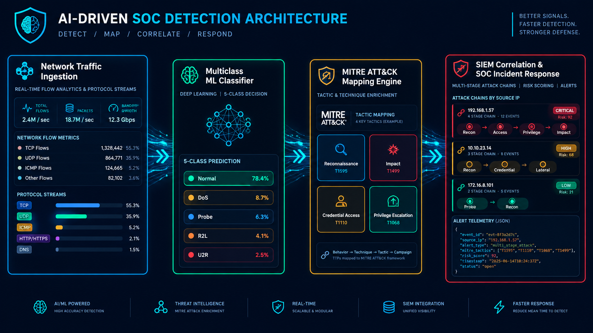

# ML-Powered Intrusion Detection — ATT&CK Correlation

Détection d'intrusions réseau **multiclasse** sur NSL-KDD (régression logistique), mapping des attaques vers **MITRE ATT&CK**, puis démonstration d'une **corrélation de type SIEM** sur des logs d'infrastructure simulés.

[](https://colab.research.google.com/drive/1ASvIWpIBysMLx4bvfcdCrOQwpG8YJ6Lt)
[](https://www.kaggle.com/datasets/shakirjalal/nsl-kdd-datasets-in-csv-format)
[](https://attack.mitre.org/)



## Objectif

Passer d'une simple classification (normal / attaque) à une chaîne de détection exploitable par un SOC : identifier la **famille** d'attaque, la relier à une **tactique et une technique ATT&CK**, regrouper les alertes par source en **incidents** et mesurer ce que le modèle ne voit pas.

```
Logs réseau -> Préparation -> Modèle multiclasse -> Triage -> Mapping ATT&CK -> Corrélation par IP -> Alertes JSON
```

## Données

- Source : [NSL-KDD au format CSV (Kaggle)](https://www.kaggle.com/datasets/shakirjalal/nsl-kdd-datasets-in-csv-format), fichiers `KDDTrain.csv` (125 973 lignes) et `KDDTest.csv` (22 544 lignes).
- 41 variables, l'attaque précise (`attack`) et un score de difficulté (`level`), exclu des variables explicatives.
- 5 classes : `normal`, `DoS`, `Probe`, `R2L`, `U2R`.
- Entraînement : 23 types (22 attaques et `normal`). Test : 38 types, dont 17 absents de l'entraînement (3 750 lignes, soit 16,6 % du test).
- Fort déséquilibre :

| Famille | Train | Test |
|---|---|---|
| normal | 67 343 | 9 711 |
| DoS | 45 927 | 7 460 |
| Probe | 11 656 | 2 421 |
| R2L | 995 | 2 885 |
| U2R | 52 | 67 |

Les données ne sont pas incluses dans ce dépôt.

## Mapping familles et MITRE ATT&CK

Le regroupement en 4 familles est celui de la littérature NSL-KDD. Le rattachement à ATT&CK est une **proposition d'analyse** : il n'existe pas de mapping officiel pour ce dataset, et les identifiants sont à valider dans l'ATT&CK Navigator.

| Famille | Attaques | Tactique | Technique proposée |
|---|---|---|---|
| DoS | neptune, processtable | Impact | T1499.001 OS Exhaustion Flood |
| DoS | smurf | Impact | T1498.002 Reflection Amplification |
| DoS | back, teardrop, pod, land | Impact | T1499.004 Application or System Exploitation |
| Probe | ipsweep, portsweep, nmap | Reconnaissance | T1595.001 Scanning IP Blocks |
| Probe | satan, saint, mscan | Reconnaissance | T1595.002 Vulnerability Scanning |
| R2L | guess_passwd, snmpguess | Credential Access | T1110.001 Password Guessing |
| R2L | ftp_write, imap, phf, sendmail, named | Initial Access | T1190 Exploit Public-Facing Application |
| R2L | warezclient, warezmaster | Command and Control | T1105 Ingress Tool Transfer |
| U2R | buffer_overflow, loadmodule, perl, ps, xterm, sqlattack | Privilege Escalation | T1068 Exploitation for Privilege Escalation |
| U2R | rootkit | Defense Evasion | T1014 Rootkit |

Le mapping complet (38 types) est dans le notebook. Deux familles posent problème : `worm` et `httptunnel` sont classés différemment selon les sources.

## Méthodologie

1. Chargement depuis Google Drive, vérification des en-têtes, exploration des types d'attaques.
2. Mapping attaque -> famille -> tactique / technique ATT&CK.
3. Préparation : one-hot de `protocol_type`, `service`, `flag` (122 colonnes), alignement du test sur les colonnes de l'entraînement, `StandardScaler` ajusté sur l'entraînement uniquement.
4. Régression logistique multiclasse, avec et sans `class_weight="balanced"`.
5. Évaluation sur `KDDTest` : matrice 5x5, recall par classe, macro-F1, attaques connues contre inconnues, couverture par tactique.
6. Analyse du seuil, du triage et d'un raccourci appris par le modèle.
7. Démonstration SIEM sur 69 événements simulés.

## Résultats

| Modèle | Accuracy | Macro-F1 | Fausses alertes (trafic normal) | Détection des attaques |
|---|---|---|---|---|
| Standard | 76,5 % | 0,590 | - | - |
| Pondéré (balanced) | 78,4 % | 0,583 | 8,5 % | 73,7 % |
| Pondéré, sans `service` | 80,9 % | 0,625 | 6,0 % | 75,7 % |

Par classe, pour le modèle final (pondéré, sans `service`) :

| Classe | Precision | Recall |
|---|---|---|
| normal | 0,745 | 0,940 |
| DoS | 0,969 | 0,828 |
| Probe | 0,818 | 0,830 |
| R2L | 0,911 | 0,306 |
| U2R | 0,068 | 0,507 |

### Généralisation et couverture ATT&CK

Avec le modèle pondéré initial, la famille est correcte à 86,1 % sur les types d'attaques déjà vus et seulement à 39,5 % sur les types nouveaux. Par tactique :

| Tactique | Exactitude |
|---|---|
| Impact | 84,7 % |
| Reconnaissance | 78,6 % |
| Privilege Escalation | 48,1 % |
| Command and Control | 45,9 % |
| Initial Access | 10,8 % |
| Credential Access | 1,9 % |
| Collection | 0,0 % |

Un modèle sur statistiques de connexion couvre bien Impact et Reconnaissance, et presque pas Credential Access et Collection, qui exigent des journaux d'authentification et applicatifs.

### Un raccourci appris : `service = private`

Le trafic normal vers un service `private` est signalé à tort dans 71,2 % des cas, contre 2,5 % pour les autres services. Cette modalité explique environ trois quarts des fausses alertes. Retirer les variables `service_*` améliore à la fois l'accuracy, le macro-F1, la détection et le taux de fausses alertes.

## Démonstration SIEM

Un jeu de 69 événements est généré avec des lignes réelles de `KDDTest`, enrichies d'IP, d'horodatages et d'hôtes fictifs (chaîne d'attaque, SYN flood, angles morts, trafic normal). Le fichier de logs n'a aucune étiquette ; les vérités sont dans un fichier séparé.

La couche de décision ajoute :

- un triage en trois niveaux : `ALERTE` (P > 0,5), `A INVESTIGUER` (P > 0,2), `Normal` ;
- le mapping ATT&CK (tactique, technique, candidats avec leur fréquence) ;
- une corrélation par IP source avec règles distinctes pour les sources internes et externes ;
- une sévérité `critical` réservée aux sources ayant au moins 2 alertes fortes (P >= 0,8) dans au moins 2 tactiques ;
- un export JSON avec des champs inspirés d'ECS (`threat.framework`, `threat.tactic.name`, `threat.technique.id`).

Résultat sur le jeu simulé : 30 alertes (21 justifiées), 4 incidents dont 3 réels. La chaîne Reconnaissance -> Privilege Escalation de la source principale est la seule classée `critical`, et le faux incident d'un poste interne (score moyen 0,47) est ramené à `low`.

| IP source | Alertes | Score moyen | Sévérité | Incident réel |
|---|---|---|---|---|
| 203.0.113.45 | 13 | 0,96 | critical | Oui |
| 198.51.100.23 | 6 | 1,00 | high | Oui |
| 192.0.2.99 | 2 | 0,87 | high | Oui |
| 10.10.40.35 | 4 | 0,47 | low | Non |

Angles morts : `snmpguess` et `processtable` (aucune alerte), et 2 tentatives de brute force FTP sur 4.

## Limites

- NSL-KDD est ancien (famille KDD'99) : le trafic et les attaques ne reflètent pas les environnements actuels.
- Le retrait de `service` a été décidé après observation du jeu de test : les scores correspondants sont légèrement optimistes. Une validation séparée et une validation croisée seraient nécessaires.
- U2R reste peu fiable (precision 6,8 %) et R2L est mal détecté (recall 30,6 %).
- Le mapping ATT&CK par famille masque la diversité de R2L (91 % de `warez`) ; un classifieur par type d'attaque serait plus juste.
- Les logs de la démonstration sont simulés. En production, les variables de fenêtre (`count`, `srv_serror_rate`, `dst_host_*`) doivent être calculées par agrégation, et celles de contenu (`num_failed_logins`, `root_shell`...) viennent de journaux d'hôte, pas du réseau.
- Le modèle est linéaire et surconfiant hors distribution.

## Pistes d'amélioration

- Classifieur par type d'attaque (22 classes) puis mapping ATT&CK.
- Random Forest ou XGBoost, calibration des probabilités, détection d'anomalies pour les attaques inconnues.
- Validation croisée et jeu de validation dédié.
- Test sur des données plus récentes (CIC-IDS2017, UNSW-NB15).
- Calcul des variables à partir de journaux Zeek / Suricata et intégration à Wazuh.

## Exécution

1. Ouvrir le notebook via le badge Colab.
2. Télécharger `KDDTrain.csv` et `KDDTest.csv` depuis Kaggle et les placer dans Google Drive, dans `AI-Cyber/NSL-KDD-dataset/`.
3. Monter Drive et exécuter les cellules dans l'ordre.

Bibliothèques : `pandas`, `numpy`, `scikit-learn`.

## Auteur

Othmane — [GitHub](https://github.com/othmane71-art)
